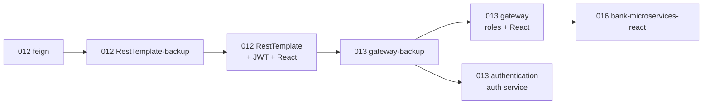

# CSB Training – Mohit

Coursework from the NIIT Java Full Stack training program, by day: core Java, JDBC, Spring Boot, security, microservices, React, and DevOps (Docker, Kubernetes, Jenkins, testing).

## Start here
| Project | Why |
| --- | --- |
| [`Day 016/React/bank-microservices-react`](Day%20016/React/bank-microservices-react/README.md) | The most complete work: five Spring Boot services, gateway, JWT roles, MySQL + Flyway, React, Docker, Kubernetes, Jenkins, 118 tests. |
| [`Day 013/Classwork/microservices-gateway`](Day%20013/Classwork/microservices-gateway/README.md) | Gateway + Eureka + role-based security + React; what the bank project builds on. |
| [`Day 008/Assigment/hospital-management`](Day%20008/Assigment/hospital-management/README.md) | Large Spring Boot assignment with tests. |
| [`Docker`](Docker/README.md), [`Kubernets`](Kubernets/README.md), [`Jenkins Work`](Jenkins%20Work/README.md), [`Testing`](Testing/README.md) | Reusable how-to material. |

## By day
| Days | What's there |
| --- | --- |
| 001–005 | Agile PDF; basic Java, OOP, interfaces, threads, file I/O, collections, SQL; the console `testbank` app (`Day 005/Homework (assignments)/testbank`, Java 8, JDBC, MySQL) |
| 006 | JDBC console apps with the DAO pattern (employee directory, bookstore, bank transfer, orders, expenses, performance, a connection pool, `mini-wallet`) and Spring core examples |
| 007 | 17 Spring Boot assignments, `01-ioc-bean-creation` to `17-transactions`, each with a README |
| 008–010 | Spring JDBC movies; `hospital-management`; REST API exercises; `hotelcrud`; seven Spring Security exercises; JPA mappings, logging, pagination, native Hibernate |
| 011 | Spring Security samples: basic, JDBC users, JWT; a customer API |
| 012–013 | Microservices, below; [`identity-service`](Day%20013/Classwork/identity-service/README.md); `microservices-demo` (product and order services with Docker/Kubernetes files) |
| 016 | React exercises (basics, routing, forms, Bootstrap, dashboards) and the bank project |

## The microservices work (Day 012 to 016)
One system that grows stage by stage (order inferred from comparing the code):

READMEs: [feign](Day%20012/microservices-feign/README.md), [RestTemplate-backup](Day%20012/microservices-RestTemplate-backup/README.md), [RestTemplate](Day%20012/microservices-RestTemplate/README.md), [gateway-backup](Day%20013/Classwork/microservices-gateway-backup/README.md), [gateway](Day%20013/Classwork/microservices-gateway/README.md), [authentication](Day%20013/Classwork/microservices-authentication/README.md). The `-backup` folders are earlier stages, not copies.

## Running things
- Days 002–005: each exercise has its own `main`; run it from an IDE.
- Maven projects: `mvn spring-boot:run` (or the `*App` main class for Day 006) from the project folder. Many need a local MySQL.
- Several services use port **8081**, which Jenkins also uses here; override with `--server.port`.
- Keep credentials out of the repo: environment variables or git-ignored files (the bank project shows how).

## Worth knowing
`Day 010/Class Work/spring-boot-pagination-sorting-main` contains a second copy of itself. `Day 012/microservices-react` and `GitLab CI CD Project` hold only IDE metadata.
