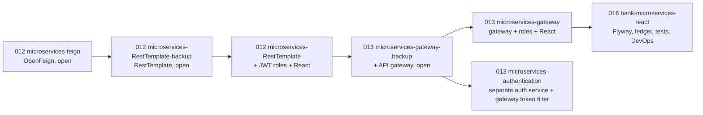

# CSB Training – Mohit

Coursework from the NIIT Java Full Stack training program, organised by day: core Java, JDBC, Spring and Spring Boot, security, microservices, React, and the DevOps tools around them (Docker, Kubernetes, Jenkins, testing).

`Progressive_Banking_Project_Description.pdf` is the specification for the course's main banking project. [`DOCUMENTATION_AUDIT.md`](DOCUMENTATION_AUDIT.md) lists which folders have a README, how well each was checked, and what was deliberately left out.

> How the READMEs in this repository were made: written from reading the source code and configuration. Unless a README says "verified", commands in it were **not run** while it was written. Several projects contain default passwords or secrets in their config files; the READMEs never repeat those values.

## Where to start
The projects worth reading first, because they show whole systems rather than single exercises:

| Project | Why |
| --- | --- |
| [`Day 016/React/bank-microservices-react`](Day%20016/React/bank-microservices-react/README.md) | The most complete work: five Spring Boot services, a gateway, JWT with roles, MySQL with Flyway migrations, a React front end, Docker, Kubernetes and a Jenkins pipeline, with 118 unit tests. |
| [`Day 013/Classwork/microservices-gateway`](Day%20013/Classwork/microservices-gateway/README.md) | Gateway + Eureka + role-based security + React; the design the bank project builds on. |
| [`Day 008/Assigment/hospital-management`](Day%20008/Assigment/hospital-management/README.md) | Large Spring Boot assignment with tests and a compose file. |
| [`Docker`](Docker/README.md), [`Kubernets`](Kubernets/README.md), [`Jenkins Work`](Jenkins%20Work/README.md), [`Testing`](Testing/README.md) | Reusable how-to material: containers, deployments, a CI/CD pipeline, JUnit and Spring tests. |

## Day by day

### Days 001 to 005: Java fundamentals (no project structure)
| Folder | What's inside |
| --- | --- |
| `Day 001` | Agile assignment: stakeholders, product vision and user stories for an e-commerce app (PDF) |
| `Day 002` | Basic Java programs (conditions, loops, methods) and Git/DevOps assignment reports (PDF) |
| `Day 003` | OOP: classes, constructors, static members, inheritance, polymorphism, searching, String methods |
| `Day 004` | Abstract classes, interfaces, custom exceptions, threads, file I/O, and functional interfaces (`Predicate`, `Function`, `Consumer`, `Supplier`) |
| `Day 005` | Collections, user-defined exceptions, SQL schema assignments, and the `testbank` project (below) |

### Day 006: JDBC and Spring core
Plain Java console apps over MySQL using the DAO pattern (each has a `*App` main class and a `DBConnection`):

| Project | One line |
| --- | --- |
| `Assigments/1. employee-directory` | Employees and departments with sorting |
| `Assigments/2. bookstore-inventory` | Books and authors, with a properties-file configuration |
| `Assigments/3. bank-transfer` | Account transfers, with a concurrency demo and an inactive-account rule |
| `Assigments/4. order-processing` | Customers, orders and order items |
| `Assigments/6. expense-import` | Expense records, benchmarks and import (there is no assignment 5 folder) |
| `Assigments/7. employee-performance` | Employee reviews and rating bands |
| `Assigments/8. audit-connection-pool` | A hand-written connection pool with exhaustion and load-test demos |
| `Assigments/mini-wallet` | JDBC capstone: wallets, transfers, batch operations, reports, pooling |
| `Class Work/springcoreexamples`, `Class Work/SpringAnnotationDemo` | Spring core: bean configuration and annotations (Maven projects) |

### Day 007: Spring Boot fundamentals (17 assignments, each with its own README)
`Assignments/Day 07 Assigments/` holds `01-ioc-bean-creation`, `02-constructor-injection`, `03-component-scanning`, `04-bean-scope`, `05-primary-qualifier`, `06-bean-lifecycle`, `07-spring-boot-autoconfig`, `08-external-config`, `09-spring-profiles`, `10-rest-controller-mappings`, `11-request-body-dto`, `12-bean-validation`, `13-global-exception-handling`, `14-spring-data-jpa-crud`, `15-jpa-one-to-many`, `16-service-layer` and `17-transactions`. The folder names say what each covers; `14-spring-data-jpa-crud` is the product API that `Testing/product-catalog-testing` was copied from.

### Day 008 to 010: persistence, REST and security
| Project | One line |
| --- | --- |
| `Day 008/Assigment/hospital-management` | Large hospital system (appointments, doctors, patients, reports) with README, tests and compose |
| `Day 008/Class Work/moviespringjdbc` | Movie CRUD with Spring JDBC and Thymeleaf |
| `Day 009/Assigment/api-exercises` | Three REST API exercises (`01-employee-rest-api`, `02-product-rest-api`, `03-secure-rest-api`), each with a README |
| `Day 009/Class Work/hotelcrud` | Hotel management with Spring Data JPA and OpenAPI |
| `Day 010/Assignments` | Seven Spring Security exercises: `01-basic-security`, `02-roles-authorities`, `03-method-security`, `04-database-auth`, `05-jwt`, `06-secure-rest-api`, `07-security-tests` (each has a README) |
| `Day 010/Class Work` | `flight-native-hibernate-crud` (native Hibernate), `OneToOneUniDirectional` (student and Aadhaar card), `OneToManyUniDirectional` (department and employees), `springboot-file-logging` (logging to a file), `spring-boot-pagination-sorting-main` (pagination and sorting; the folder exists twice, nested) |

### Day 011: Spring Security samples
| Project | One line |
| --- | --- |
| `customer-service` | Customer REST API with OpenAPI |
| `spring-day-5-springsecurity-example` | Basic Spring Security demo |
| `spring-security-jdbc-mysql` | Users stored in MySQL through JDBC, with a registration endpoint |
| `spring-security-jwt-master` | JWT filter on an older Spring Boot (2.1.x); a reference sample |

### Day 012 and 013: microservices (one evolving system)
The order below is inferred from comparing the code (what each folder adds to the previous one), not from file dates.

| Folder | README |
| --- | --- |
| `Day 012/microservices-feign` | [yes](Day%20012/microservices-feign/README.md) |
| `Day 012/microservices-RestTemplate-backup` | [yes](Day%20012/microservices-RestTemplate-backup/README.md) (a middle stage, not a duplicate) |
| `Day 012/microservices-RestTemplate` | [yes](Day%20012/microservices-RestTemplate/README.md) |
| `Day 012/microservices-react` | none: contains only IDE metadata |
| `Day 013/Classwork/microservices-gateway-backup` | [yes](Day%20013/Classwork/microservices-gateway-backup/README.md) (an earlier stage of the gateway project, not a copy) |
| `Day 013/Classwork/microservices-gateway` | [yes](Day%20013/Classwork/microservices-gateway/README.md) |
| `Day 013/Classwork/microservices-authentication` | [yes](Day%20013/Classwork/microservices-authentication/README.md) (plus one per service) |
| `Day 013/Classwork/identity-service` | [yes](Day%20013/Classwork/identity-service/README.md) and its own `NOTES.md` |
| `Day 013/Assigment/microservices-demo` | existing README (product and order services with Docker and Kubernetes files) |

### Day 016: React and the full-stack bank
`Day 016/React/` holds `Assignments` (`react-basics`, `employee-directory`, `Bootstrap/employee-dashboard` and the routing/forms exercises numbered 01 to 15 under `routing exercises` (eight folders), each with a README), `BootstrapDemo`, `Hotel/hotelDashboard`, `Learning`, `student-dashboard`, and [`bank-microservices-react`](Day%20016/React/bank-microservices-react/README.md), which has a README for the project and for each service.

### DevOps and testing
| Folder | What it is |
| --- | --- |
| [`Docker`](Docker/README.md) | Hello World image, packaging a jar, volume mounting, and a 5-container Compose setup |
| [`Kubernets`](Kubernets/README.md) | A Spring Boot app deployed with a 3-replica Deployment and a NodePort Service |
| [`Jenkins Work`](Jenkins%20Work/README.md) | A Spring Boot app with a Jenkins pipeline: build the jar, build a Docker image, run it as a container; Kubernetes manifests are included |
| [`Testing`](Testing/README.md) | JUnit 5 practice, Spring Boot tests, and `product-catalog-testing` |
| `GitLab CI CD Project` | empty apart from IDE metadata (its project is no longer here) |

## testbank
A console-based banking application (Phases 1–3 of the banking project spec), located at `Day 005/Homework (assignments)/testbank`.

- **Features:** manage customers and accounts; deposit, withdraw and transfer money; view transaction history by account, type or date range
- **Structure:** `entity` → `dao` (JDBC) → `service` → `controller` (`MainBank` is the entry point)
- **Tech:** Java 8 (`maven.compiler.source` 1.8), Maven, MySQL (`mysql-connector-j`), JUnit 5 (one test class, `BankingApplicationTest`)

To run it, create a MySQL database named `testbank` with `customer`, `account` and `transaction` tables, update the connection details in `util/DBConnection.java`, and run `MainBank`.

## Running the exercises
- Days 002 to 005: each exercise is a standalone program with its own `main` method; run it from an IDE.
- Maven projects: `mvn spring-boot:run` (Spring Boot) or run the `*App` main class (Day 006), from the project folder. Many need a **local MySQL**; check the project's configuration for the database name and user.
- Port clashes: several services use **8081**, which Jenkins also uses on this machine; override with `--server.port`.
- Keep real credentials out of the repository: use environment variables or git-ignored files (the bank project shows how).

## Folders that are not what they look like
- `*-backup` folders (`microservices-RestTemplate-backup`, `microservices-gateway-backup`) are **earlier stages** of a project, not copies; each says so in its README.
- `Day 010/Class Work/spring-boot-pagination-sorting-main` contains a second copy of itself.
- `Day 012/microservices-react` and `GitLab CI CD Project` hold only IDE metadata.
